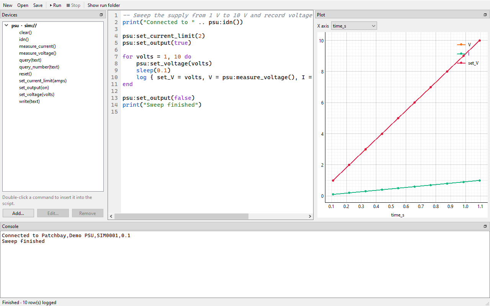

# Benchloom

[](https://github.com/criscrafter/benchloom/actions/workflows/tests.yml)
[](LICENSE)

Open-source lab automation: an alternative to LabVIEW for small labs, makers
and test benches. Connect your instruments (power supplies, loads, scopes,
generators, meters) and build a test either by wiring nodes together or by
writing a Lua script. Each run leaves its data, waveform images and a
PASS/FAIL report behind. No licence fees, no accounts, no vendor runtime.

**Documentation: <https://criscrafter.github.io/benchloom/>**



> **Status: early (0.2).** Benchloom works and is used on a real bench, but it
> is young: it has been tested on Windows 10 only so far, and interfaces may
> still change. See the [roadmap](docs/PLAN.md).

> **Safety:** Benchloom switches real power supplies, loads and generators. A
> wrong script can apply a wrong voltage or current to your circuit. Set limits
> on the instruments themselves, try new tests on the simulators first, and stay
> near the bench the first time a test runs. Drivers switch outputs off when a
> test ends or is stopped, but that cannot replace a hardware limit. See
> [Safety and security](docs/safety.md).

## Try it

**Windows:** download `Benchloom-…-windows-x64.zip` from the
[latest release](https://github.com/criscrafter/benchloom/releases/latest),
unzip it and start `Benchloom.exe`. No installation and no Python needed.

**With pip** (Python 3.11 or newer):

```
pip install "benchloom[gui,usb]"
benchloom gui
```

Choose **New project** and press **Run** (F5): the example sweeps a simulated
power supply, so it runs without hardware.
[Getting started](docs/getting-started.md) goes on from there.

## What it does

- **Tests as [Lua scripts](docs/lua.md) or [visual graphs](docs/visual-tests.md)**,
  both run by the same sandboxed engine, with pass/fail checks and saved
  waveforms.
- **A [front panel](docs/front-panel.md)** with inputs, switches, gauges, charts
  and tables for a running test.
- **A run folder per run**: `data.csv`, console log, checks, waveforms and an
  HTML report, plus a run history to compare runs.
- **A [command line](docs/command-line.md)** for test PCs, scripts and CI.
- **[Instruments](docs/INSTRUMENTS.md)** over serial, network, GPIB (Prologix,
  AR488, xyphro UsbGpib, VISA) and USB, each with a simulator: Kunkin KP184,
  Chroma 6404, Hantek DSO5102P, Feeltech FY6900, HP/Agilent/Keysight 6655A,
  3478A, 3458A, 34420A, 34970A, 53131A, 5384A and 5334A, Fluke 8508A, Wavetek
  1281 and 4950, Digitek DT-4000ZC, and any SCPI or line-based serial
  instrument. The instruments page says which were tried on real hardware.
- **[Plugins](docs/writing-plugins.md)** in Python for your own instruments,
  and a [plugin registry](registry/README.md) to share them.

## Development

```
git clone https://github.com/criscrafter/benchloom
cd benchloom
python -m venv .venv
.venv\Scripts\pip install -e ".[gui,usb,dev]"    # Linux/Mac: .venv/bin/pip
.venv\Scripts\pytest
```

The tests use the instruments' simulators, so they need no hardware.
Contributions are welcome; see [CONTRIBUTING.md](CONTRIBUTING.md). Pull
requests need agreement to the [Contributor License Agreement](CLA.md).
Security problems: see [SECURITY.md](SECURITY.md).

Benchloom is developed with substantial assistance from AI tools. Every change
is reviewed by the maintainer and checked by the test suite; where the
documentation says a driver was tried on real hardware, the maintainer ran it
on that instrument.

## Licence

Benchloom is free software under the **GNU Affero General Public License 3.0**
or later ([LICENSE](LICENSE)), provided without warranty; see
[Licence](docs/licence.md) for the full disclaimer. Your own tests and projects
are yours: the project templates are under MIT-0. Commercial licences are
available for building Benchloom into a closed product; contact the maintainer
through [GitHub](https://github.com/criscrafter). Third-party code is listed in
[THIRD_PARTY_NOTICES.md](THIRD_PARTY_NOTICES.md).

Instrument names and trademarks belong to their owners. Benchloom is not
affiliated with or endorsed by any instrument maker. It was called "Patchbay"
during its development; projects and settings from that time keep working.
