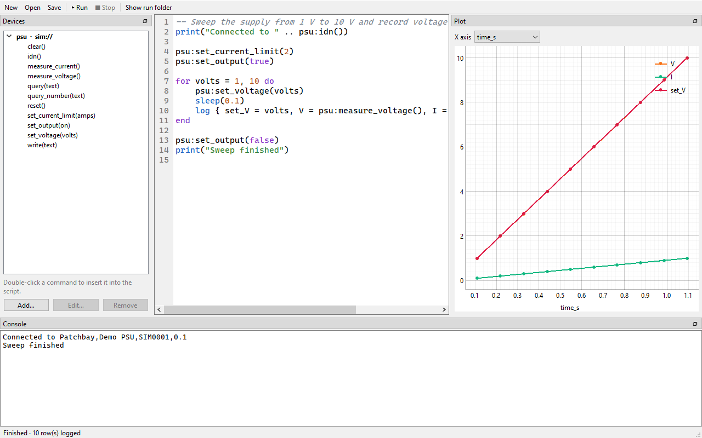
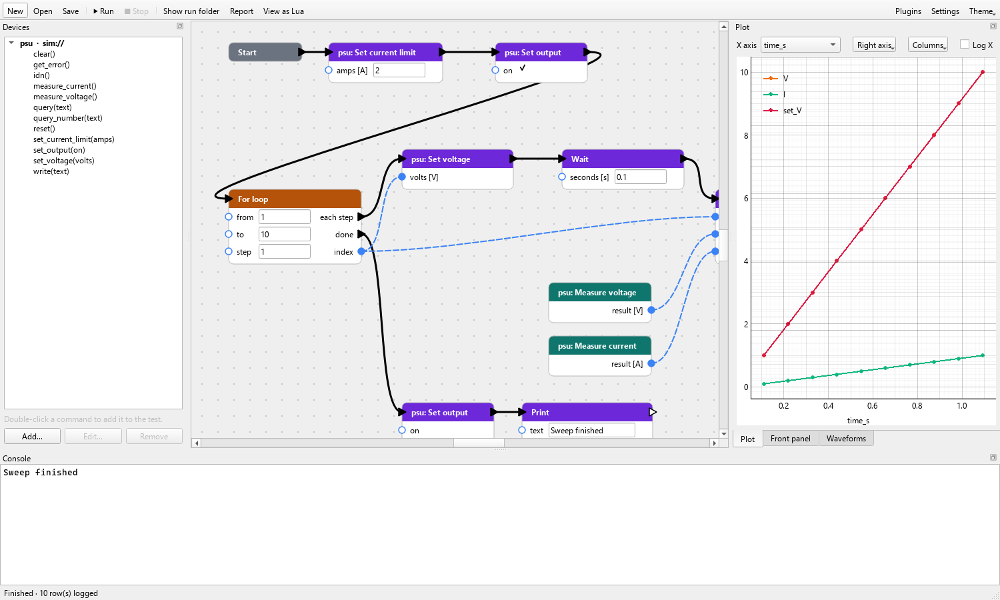
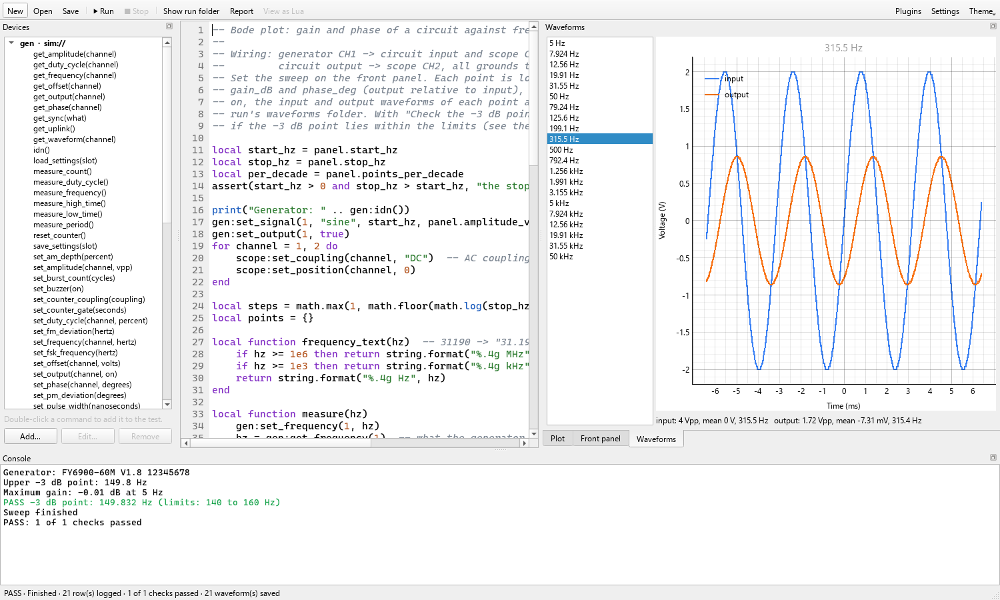
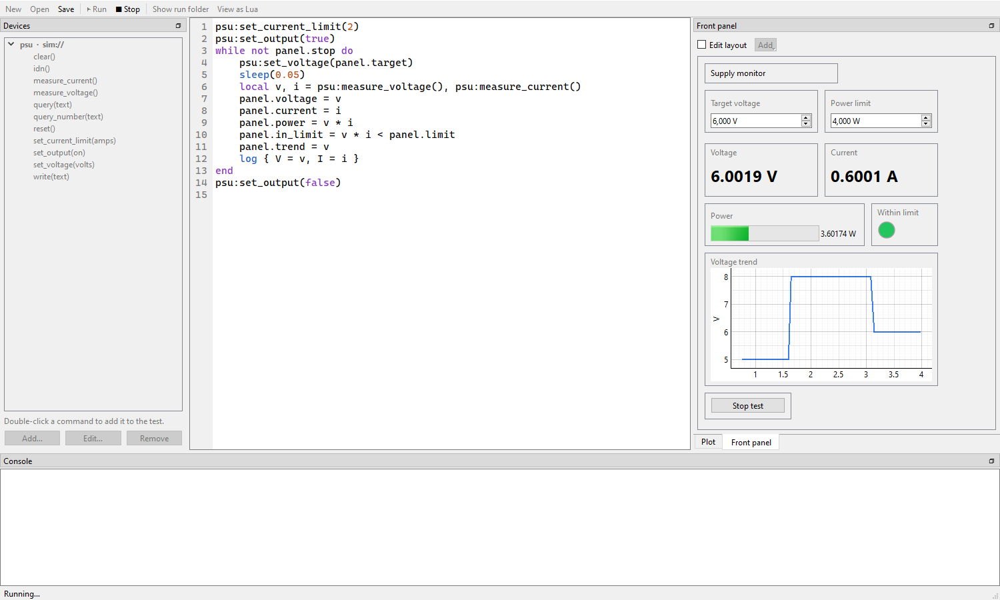

# Benchloom

[](https://github.com/criscrafter/benchloom/actions/workflows/tests.yml)
[](LICENSE)

Open-source lab automation: an alternative to LabVIEW for small labs, makers
and test benches. Connect your instruments (power supplies, loads, scopes,
generators, meters) and build a test either by wiring nodes together or by
writing a Lua script. Each run leaves its data, waveform images and a
PASS/FAIL report behind.

The goal is a short path from "I need to automate this" to a running setup,
without licence fees, accounts or a vendor runtime.

**Documentation:** <https://criscrafter.github.io/benchloom/>, with getting
started, the Lua reference, visual tests, the front panel, instruments and
writing plugins.



> **Status: early (0.1).** Benchloom works and is used on a real bench, but it
> is young: it has been tested on Windows 10 only so far, and interfaces may
> still change. See [docs/PLAN.md](docs/PLAN.md) for what is missing.

> **Safety:** Benchloom switches real power supplies, loads and generators.
> A wrong script can apply a wrong voltage or current to your circuit. Set
> current limits on the instruments themselves, try new tests on the
> simulators first, and stay near the bench the first time a test runs.
> Drivers switch outputs off when a test ends or is stopped, also when its
> script does not stop (only a run that hangs completely is killed as it is),
> but that cannot replace a hardware limit.
> Benchloom is provided without warranty; see [Disclaimer](#disclaimer).

## Try it

**Windows:** download `Benchloom-…-windows-x64.zip` from the
[latest release](https://github.com/criscrafter/benchloom/releases/latest), unzip
it and start `Benchloom.exe`. No installation and no Python needed. Windows may
warn about an unknown publisher because the program is not signed: choose
"More info" and "Run anyway".

**With pip** (Windows, Linux), with Python 3.11 or newer:

```
pip install "benchloom[gui,usb]"
benchloom gui
```

**From source** (needed for development):

```
git clone https://github.com/criscrafter/benchloom
cd benchloom
python -m venv .venv
.venv\Scripts\pip install -e ".[gui]"    # Linux/Mac: .venv/bin/pip
.venv\Scripts\benchloom gui
```

`usb` adds USB instruments such as the Hantek scope (`".[gui,usb]"` from
source), `visa` adds VISA instruments.

Choose **New project**, pick **Visual** or **Lua script**, then press **Run**
(F5). The project starts with a simulated power supply and a voltage sweep, so
it runs without hardware. Add real instruments in the Devices panel;
double-click a command there to add it to the test.

**Start from** offers ready-made projects as well:

- **Bode plot:** gain and phase of a circuit against frequency, with a
  Feeltech FY6900 generator and a Hantek DSO5102P scope. Wire generator CH1 to
  the circuit's input and to scope CH1, and the circuit's output to scope CH2.
  Set the sweep on the front panel; the plot shows gain and phase on a log
  frequency axis, and the script measures the -3 dB points (3 dB below the
  maximum gain, on either side, so low-, high- and band-passes all work). The
  input and output waveform of each point are saved as images, and the -3 dB
  point can be checked against limits for a PASS/FAIL verdict. It starts on
  simulators with a simulated RC low-pass; set the two resources for real
  hardware.

Each run gets a folder under the project's `runs/` holding `data.csv`,
`console.log`, `run.json`, a copy of the script, `checks.csv` and `waveforms/`
when the test made checks or saved waveforms, and `report.html`: one page with
the PASS/FAIL verdict, the checks, a chart of the data, the waveform images, the
devices, the data table and the console. **Report** in the toolbar opens it.
The **Runs** tab lists past runs; **Compare** draws one dashed next to the
current curves.

The same works without the app:

```
benchloom new my-test
benchloom new my-filter --template bode
benchloom run my-test
benchloom devices             # device types the installed plugins provide
benchloom describe demo.psu   # commands of one device type
benchloom plugins             # plugins found, and whether they are on
```

## A project

`benchloom.toml` lists the instruments; the entry name is the name in the test.

```toml
[project]
name = "my-test"
mode = "lua"          # or "visual"
script = "main.lua"

[devices.psu]
device = "demo.psu"
resource = "sim://"

[plot]                # optional: how the plot starts out
x = "set_V"           # the column for the X axis
log_x = false         # a log scale for X, for frequency sweeps
right = ["I"]         # columns on the right-hand scale
hide = ["time_s"]     # columns not drawn
columns = ["set_V", "V", "I"]  # the order of the logged columns
```

| Resource | Connection |
|---|---|
| `sim://` | the plugin's simulator |
| `serial://COM3?baud=9600` | serial port (`serial:///dev/ttyUSB0` on Linux) |
| `tcp://192.168.1.20:5025` | raw socket |
| `prologix://COM4/5` | GPIB address 5 through a Prologix or AR488 adapter |
| `visa://GPIB0::5::INSTR` | any VISA resource, including vendor GPIB adapters (`pip install "benchloom[visa]"`) |

## A visual test



Nodes are connected by two kinds of wire:

- **Thick wires** say what runs next. Follow them from the Start node.
- **Dashed blue wires** carry values from an output to an input.

Inputs without a wire are typed into the node. Right-click the canvas to add
nodes (loops, conditions, math, logging, and every command of the project's
devices); drag from pin to pin to wire; select and press Delete to remove.
Ctrl+Z and Ctrl+Y undo and redo; Ctrl+C, Ctrl+X and Ctrl+V copy, cut and paste
the selected nodes with the wires between them (also into another project), and
Ctrl+D duplicates them. The canvas and node menus offer the same.

Nodes without thick-wire pins, such as a measurement, run each time a node
that uses their value runs. To measure at a fixed point instead and keep the
value, right-click the node and choose **Run in sequence**.

A visual test is compiled to Lua and run by the same engine as a script.
While it runs, a green outline marks the node it is at, and a node that
fails is outlined in red. **View as Lua** shows the generated code; each run
folder keeps it as `graph.lua`.

## A script

```lua
psu:set_voltage(5)
psu:set_output(true)
sleep(0.5)
log { V = psu:measure_voltage(), I = psu:measure_current() }
```

Besides the devices, a script has `sleep(seconds)`, `log{...}` (one row in
`data.csv`, the plot and the Data tab), `time()` (seconds since start), `print(...)` and `panel` (the
front panel, below), and:

- `check(name, value, low, high, unit)`: a pass/fail check. It passes when the
  value lies within the limits (either may be `nil`), or, without limits, when
  the value is `true`. It prints PASS or FAIL and returns whether it passed. A
  run passes only if every check passed; the verdict is in the status bar,
  `run.json` and the report. Visual tests have a **Check** node.
- `save_waveform(name, traces)`: saves scope traces as CSV, SVG and PNG under
  the run's `waveforms/` folder and shows them in the **Waveforms** tab while
  the test runs. `traces` is what `read_waveform` returns, or several of those
  by name: `save_waveform("ripple", scope:capture())` saves every channel that
  is on. PNG images need the desktop app installed; the SVG images are always
  made. Visual tests have a **Save waveform** node.



```lua
local v = psu:measure_voltage()
check("Output voltage", v, 4.9, 5.1, "V")
save_waveform("output", { output = scope:read_waveform(2) })
```

The plot draws every logged column live, against the column chosen as X axis
(time by default). Columns of very different size, such as 230 V and 10 W, can
go on a second scale under **Right axis**, **Columns** hides curves, and
**Log X** puts the X axis on a log scale. A project's `[plot]` section sets
how the plot starts out; changes made in the plot are kept per project.

Scripts run in a sandbox. They have Lua's math, string, table, utf8 and
coroutine libraries, `os.time`, `os.clock` and `os.date`, but no access to
files, other programs or other code on the computer (no `io`, `os.execute`,
`require` and the like), and at most 1 GB of memory. A script can still command
every instrument in its project, so read a project from someone else before
running it on real hardware.

**Theme** in the toolbar switches between light, dark and the system setting.
**Settings** (Ctrl+,) also holds the projects folder, editor and console font
sizes, how many console lines to keep, opening the last project at start, and
extra folders to load plugins from.

## A front panel



The Front panel tab holds controls you operate while a test runs and
indicators the test updates. Tick **Edit layout**, use **Add**, then drag
widgets into place; double-click one for its name, caption, unit, range and
decimals. Numbers show about four significant digits without trailing zeros
(50, 140.5, -89.26) unless a widget is set to a fixed number of decimals.

| Widget | Kind | In a script |
|---|---|---|
| Number input, switch, text input | control | `panel.target` reads the current value |
| Button | control | `panel.stop` is `true` once after each click |
| Value display, indicator light, bar, gauge | indicator | `panel.voltage = v` shows a value |
| Chart | indicator | `panel.trend = v` adds a point against time; `panel.trend = { V = v, I = i }` adds one to each curve |
| Table | indicator | `panel.results = { step = n, V = v }` adds a row; `panel.results = nil` empties it |

A chart can take its X value from the table instead of the time: set
**X value** to `f` and `panel.bode = { f = 1000, gain = -3 }` draws gain
against f, on a log scale if you tick it. A table shows the columns named in
its **Columns** setting first, in that order, since a Lua table has none.

```lua
while not panel.stop do
    psu:set_voltage(panel.target)
    panel.voltage = psu:measure_voltage()
    sleep(0.1)
end
```

In a visual test the same widgets appear as nodes under **Front panel** in the
right-click menu. Renaming a widget renames its nodes too; in a script, the
app offers to change `panel.old_name` everywhere. The layout is saved in the project's `panel.json`. Run from
the command line, controls have the values they had when last run in the app.

## Instruments

| Instrument | Device type | Connection | Tried on hardware |
|---|---|---|---|
| Kunkin KP184 electronic load | `kunkin.kp184` | serial (RS-232/RS-485) | yes |
| Chroma 6404 AC source | `chroma.6404` | GPIB or serial | yes (serial, GPIB) |
| Hantek DSO5102P oscilloscope | `hantek.dso5000p` | USB | yes |
| Feeltech FY6900 function generator | `feeltech.fy6900` | USB serial | yes |
| HP 6655A power supply | `hp.6655a` | GPIB | not yet (from the manual) |
| HP 3478A multimeter | `hp.3478a` | GPIB | not yet (from the manual) |
| HP 53131A universal counter | `hp.53131a` | GPIB | not yet (from the manual) |
| Agilent 34970A data acquisition / switch unit | `hp.34970a` | GPIB, RS-232 | mainframe only (cards from the manual) |
| Digitek DT-4000ZC multimeter (FS9721 chip) | `fs9721.dt4000zc` | optical serial cable | yes |
| Any SCPI instrument | `generic.scpi` | serial, network, GPIB, VISA | – |
| Arduino and other line-based serial devices | `generic.serial` | serial, network | – |

GPIB works through the xyphro UsbGpib adapter without a vendor VISA, or
through a Prologix/AR488 adapter or a VISA.

Each comes with a simulator. [docs/INSTRUMENTS.md](docs/INSTRUMENTS.md) has
connection settings, options, what exactly was tried on hardware, and the
documentation each driver is based on. Missing your instrument? Open an
issue, or write a plugin (below). Sources and loads switch their
output off when a test ends, unless the device entry says
`leave_output_on = true`.

## A plugin

A plugin is a folder with a `plugin.toml` and Python files.
[src/benchloom/plugins/demo](src/benchloom/plugins/demo) is the reference example.

**Plugins** in the toolbar lists every plugin found, with its devices. There a
plugin can be switched off (its devices leave the Add device list and runs
refuse them), installed from a folder or a `.zip`, or removed (to the recycle
bin). Installed plugins go to `~/.benchloom/plugins/`. **Browse online** lists
plugins others wrote, from the [plugin registry](registry/), to install or
update with one click; each download is checked against the checksum in the
list. The same from the command line:

```
benchloom plugins search rigol            # the online list
benchloom plugins install rigol           # a listed plugin, by id
benchloom plugins install my-plugin.zip   # or a folder; --replace to update
benchloom plugins disable hp              # enable, remove
```

To list your own plugin, see [registry/README.md](registry/README.md).

Plugins are loaded from, in order: the built-in ones, `~/.benchloom/plugins/`,
the extra folders set in Settings, and the project's own `plugins/` folder. A
later plugin with the same id replaces an earlier one, so a project can carry
its own copy of a driver. Because a project's `plugins/` folder is Python code
that arrives with the project, it is loaded only after you allowed it for that
project: the app asks when the project is opened, and on the command line
`benchloom run my-test --trust-plugins` does it. Which plugins are off, the
extra folders and the projects allowed to load their plugins are kept in
`~/.benchloom/config.json`; set `BENCHLOOM_HOME` to use another folder than
`~/.benchloom`.

```python
from benchloom import Param, ScpiDevice, command

class MyPsu(ScpiDevice):
    @command("Set the output voltage", params={"volts": Param(unit="V", min=0, max=20)})
    def set_voltage(self, volts: float) -> None:
        self.transport.write(f"VOLT {volts}")

    @command("Measure the output voltage", unit="V")
    def measure_voltage(self) -> float:
        return float(self.transport.query("MEAS:VOLT?"))
```

Types, units and ranges declared here are checked on every call, and are what
the node editor and device panels will be generated from. A plugin can ship a
simulator (a `SimTransport` subclass that answers the instrument's commands) so
tests can be written without the hardware.

Settings of a device entry, such as a bus address, can be declared in
`plugin.toml`; the Add device dialog then shows them as fields, and the driver
reads them from `self.settings`:

```toml
[[device.setting]]
name = "address"
label = "Modbus address"
type = "int"          # int, float, bool or text
default = 1
min = 1
max = 247
help = "Set on the instrument."
```

Plugins are ordinary Python and run with full access to the computer; only
install ones you trust.

## Tests

```
.venv\Scripts\pip install -e ".[gui,dev]"
.venv\Scripts\pytest
```

The tests use the instruments' simulators, so they need no hardware.

## Contributing

Bug reports, instrument drivers and fixes are welcome; see
[CONTRIBUTING.md](CONTRIBUTING.md). Pull requests need agreement to the
[Contributor License Agreement](CLA.md). Security problems: see
[SECURITY.md](SECURITY.md).

## How Benchloom is developed

Benchloom is developed with substantial assistance from AI tools, which help
write code, tests and documentation. Every change is reviewed by the
maintainer before it is merged, and it is checked by the automated test
suite, which runs each instrument driver against a simulator. Where the
documentation says a driver was tried on real hardware, the maintainer ran it
on that instrument; [docs/INSTRUMENTS.md](docs/INSTRUMENTS.md) lists what was
tried and how.

## Disclaimer

Benchloom is provided "as is", without warranty of any kind, express or
implied, including but not limited to the warranties of merchantability,
fitness for a particular purpose and non-infringement. In no event shall the
authors or copyright holders be liable for any claim, damages or other
liability arising from the use of Benchloom, including damage to instruments,
devices under test or other equipment, injury, loss of data or incorrect
measurement results. The full terms are in sections 15 and 16 of the
[licence](LICENSE).

You are responsible for operating connected equipment safely and for checking
that results are correct for your purpose. Benchloom is not certified or
validated for safety-critical, medical, legal-metrology or other regulated
uses; using it there requires your own validation.

Instrument names and trademarks belong to their owners. Benchloom is not
affiliated with or endorsed by any instrument maker.

## Licence

Benchloom is free software under the **GNU Affero General Public License 3.0**
or later ([LICENSE](LICENSE)). You may use it, also commercially, change it and
pass it on; if you pass on a changed version, or let others use one over a
network, you must make its source available under the same licence.

- **Your tests and projects are yours.** The project templates and the example
  a new project starts with are under MIT-0
  ([src/benchloom/templates/LICENSE.txt](src/benchloom/templates/LICENSE.txt)).
- **Commercial licences** are available for companies that want to build
  Benchloom into a closed product, or keep changes to it private. Contact the
  maintainer through [GitHub](https://github.com/criscrafter).
- Code by others that Benchloom contains or uses is listed in
  [THIRD_PARTY_NOTICES.md](THIRD_PARTY_NOTICES.md).

Benchloom was called "Patchbay" during its development. Projects with a
`patchbay.toml` and the `~/.patchbay` folder from that time keep working.
