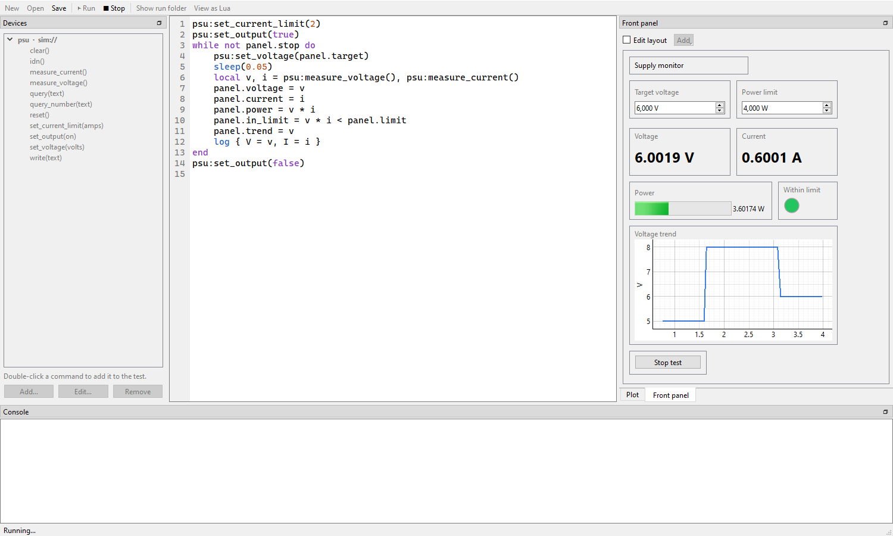

# Front panel

The **Front panel** tab holds controls you operate while a test runs and
indicators the test updates: a setpoint to change on the fly, a stop button,
a gauge of the output voltage, a chart of the last minutes.



## Building a panel

Tick **Edit layout**, choose a widget under **Add**, then drag it into place
and drag its corner to resize it. Double-click a widget (or right-click it,
**Settings…**) to set:

| Setting | For |
|---|---|
| **Name in the test** | how the test reaches it: `panel.<name>` |
| **Caption** or **Text** | what the panel shows above it, or on a button or label |
| **Unit** | shown after the value, and on a chart's axis |
| **Minimum**, **Maximum** | the range of a number input, bar or gauge |
| **Decimals** | digits after the decimal point; **Automatic** shows about four significant digits without trailing zeros (50, 140.5, -89.26) |
| **X value**, **X axis** | a chart's X value and log scale ([below](#charts)) |
| **Columns** | a table's column order ([below](#tables)) |

The layout is saved in the project's `panel.json` as you edit it. Untick
**Edit layout** to use the panel.

## Widgets

| Widget | Kind | In a script |
|---|---|---|
| Number input | control | `panel.target` is its current number |
| Switch | control | `panel.enable` is `true` or `false` |
| Text input | control | `panel.note` is its text |
| Button | control | `panel.stop` is `true` once after each click, `false` otherwise |
| Value display | indicator | `panel.voltage = v` shows a number or text |
| Indicator light | indicator | `panel.ok = true` lights it |
| Bar, gauge | indicator | `panel.level = v` fills it between minimum and maximum |
| Chart | indicator | `panel.trend = v` adds a point ([below](#charts)) |
| Table | indicator | `panel.results = { … }` adds a row ([below](#tables)) |
| Label | – | text on the panel; the test cannot reach it |

Controls can be changed while the test runs, and the test sees the new value
the next time it reads it. When a run starts, the controls' current values
are saved as their values for the next time; a run from the command line uses
those.

Setting a widget to something it cannot show, such as text on a gauge, stops
the test with an error at that line.

## Charts

A chart draws what the test sends it against time since the run started:

```lua
panel.trend = psu:measure_voltage()              -- one curve
panel.trend = { V = v, I = i }                   -- one point on each curve, with a legend
```

Its **X value** setting makes it draw against a value instead of time. With
**X value** `f` and **Log scale** ticked, this draws a Bode plot as it is
measured:

```lua
for _, f in ipairs({ 10, 20, 50, 100, 200, 500, 1000 }) do
    gen:set_frequency(1, f)
    local gain = measure_gain()                  -- your measurement
    panel.bode = { f = f, gain = gain }
end
```

Each run starts with an empty chart.

## Tables

A table adds a row each time the test sets it, and follows the newest row:

```lua
panel.results = { step = n, V = v, ok = v > 4.9 }
panel.results = nil                              -- empties it
```

Values are numbers, texts or booleans. A Lua table keeps no order, so the
table shows the columns named in its **Columns** setting first, in that order
(such as `step, V, ok`), and other columns after them. It keeps the newest
10,000 rows.

## In a visual test

Each widget appears in the node menu under **Front panel**: **Read** for
controls and **Set** for indicators.

## Renaming a widget

Renaming a widget in its settings keeps the test working: in a visual test its
nodes follow the new name, and in a script the app finds `panel.old_name` and
`panel["old_name"]` and offers to change them. Ctrl+Z in the editor undoes that.
