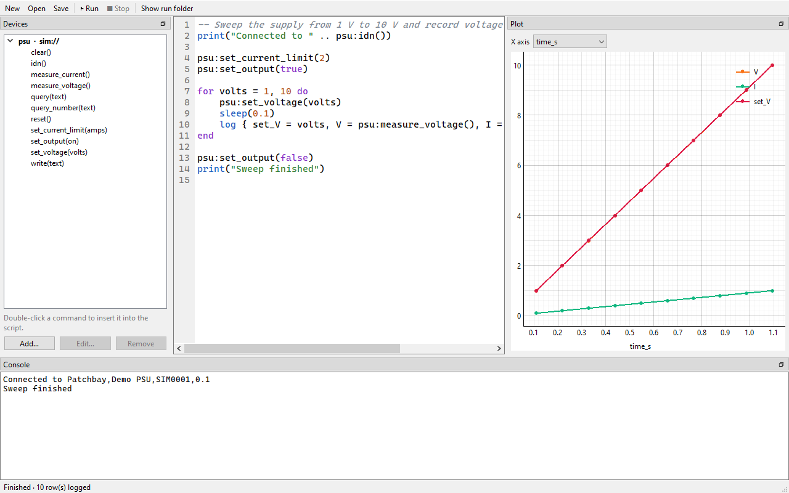

# Benchloom

Open-source lab automation: an alternative to LabVIEW for small labs, makers
and test benches. Connect your instruments (power supplies, loads, scopes,
generators, meters) and build a test either by wiring nodes together or by
writing a Lua script. Each run leaves its data, waveform images and a
PASS/FAIL report behind.

- **[Getting started](getting-started.md)**: download, first project, first
  run, on simulators, without hardware.
- **[Lua scripts](lua.md)**: everything a test script can use, with examples.
- **[Visual tests](visual-tests.md)**: tests built from nodes and wires.
- **[Front panel](front-panel.md)**: knobs, gauges, charts and tables for a
  running test.
- **[Instruments](INSTRUMENTS.md)**: the supported instruments and how to
  connect them.
- **[Writing a plugin](writing-plugins.md)**: a driver for your own instrument.

!!! warning "Safety"
    Benchloom switches real power supplies, loads and generators. A wrong
    script can apply a wrong voltage or current to your circuit. Set current
    limits on the instruments themselves, try new tests on the simulators
    first, and stay near the bench the first time a test runs. Drivers switch
    outputs off when a test ends or is stopped, but that cannot replace a
    hardware limit. See [Safety and security](safety.md).

!!! note "Status: early (0.1)"
    Benchloom works and is used on a real bench, but it is young: it has been
    tested on Windows 10 only so far, and interfaces may still change. The
    [roadmap](PLAN.md) lists what is missing.

Benchloom is free software under the AGPL-3.0, provided without warranty; see
[Licence](licence.md). The source is on
[GitHub](https://github.com/criscrafter/benchloom).
