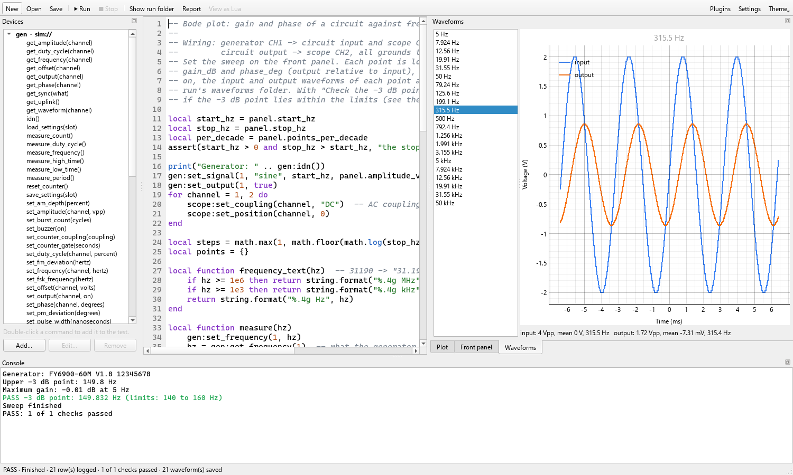

# Lua scripts

A Lua project's test is a script in [Lua 5.4](https://www.lua.org/manual/5.4/).
It runs from top to bottom; the test ends when the script does, when it fails,
or when you press **Stop**.

```lua
psu:set_voltage(5)
psu:set_output(true)
sleep(0.5)
log { V = psu:measure_voltage(), I = psu:measure_current() }
check("Output voltage", psu:measure_voltage(), 4.9, 5.1, "V")
```

## The editor

The editor offers what you can type: start a name for the project's devices and
Benchloom's functions, type `psu:` for that device's commands with their
arguments and units, or `panel.` for the front panel's widgets. Enter or Tab
takes a choice, Esc closes the list, and Ctrl+Space opens it anywhere.

While a test runs, the line it is at is marked green, and a line where it
failed is marked red.

## Instruments

Each instrument of the project is a variable named like its entry in the
project (`psu`, `scope`, …). Its commands are called with a colon:

```lua
psu:set_voltage(12)                 -- a setting
local amps = psu:measure_current()  -- a measurement returns its value
print(psu:idn())
```

The **Devices** panel lists every command with its arguments, units and
ranges; double-click one to insert it. `benchloom describe <type>` prints the
same on the command line.

Arguments are checked before anything is sent: a wrong type, a value outside
the instrument's range or a missing argument stops the test with an error that
names the line. Optional arguments can be left out or given as `nil`.
Measurements return numbers, texts or booleans; a waveform comes back as a
table (see [Waveforms](#waveforms)).

When a command fails (no answer, an error the instrument reports), the test
stops with an error at that line; the outputs are switched off as after any
test. To handle a failure yourself, use `pcall`:

```lua
local ok, err = pcall(function() return dmm:measure_voltage() end)
if not ok then print("No reading: " .. err) end
```

## Functions

| Function | Does |
|---|---|
| `sleep(seconds)` | waits; Stop ends the wait at once |
| `time()` | seconds since the run started |
| `print(...)` | writes to the console and `console.log`; several values are separated by tabs |
| `log { name = value, … }` | adds one row of data ([below](#logging-data)) |
| `check(name, value, low, high, unit)` | a pass/fail check ([below](#passfail-checks)) |
| `save_waveform(name, traces)` | saves scope traces as files and images ([below](#waveforms)) |
| `panel` | the front panel ([below](#the-front-panel)) |
| `error(message)` | ends the test as failed, with that message |

### Logging data

```lua
log { set_V = volts, V = psu:measure_voltage(), I = psu:measure_current() }
```

Each call adds a row to `data.csv`, the plot and the **Data** tab. Values are
numbers, texts or booleans. A `time_s` column with the seconds since the start
is added to each row. A row may bring new columns; earlier rows have them
empty. Lua tables have no order, so the columns are sorted by name unless the
project's [`[plot] columns`](projects.md#the-plot) says otherwise.

### Pass/fail checks

```lua
check("Output voltage", v, 4.9, 5.1, "V")   -- passes for 4.9 <= v <= 5.1
check("Ripple", ripple, nil, 0.05, "V")     -- only an upper limit
check("Fan running", fan_ok)                -- passes when the value is true
```

`check` prints `PASS` or `FAIL` with the value and the limits, records the
check in `checks.csv`, and returns whether it passed, so a test can react:

```lua
if not check("Current at 10 V", i, 0.9, 1.1, "A") then
    print("Check the load wiring")
end
```

A failed check does not stop the test. The run's verdict is **PASS** when every
check passed, **FAIL** when one did not, and none without checks; it is shown
in the status bar, `run.json` and the report. A test that ends with an error
shows **ERROR** in the report, with the checks it made until then.

### Waveforms

```lua
save_waveform("output", { output = scope:read_waveform(2) })
save_waveform("ripple", scope:capture())  -- every channel that is on
```

`save_waveform` writes the traces to the run's `waveforms/` folder as CSV, SVG
and PNG, shows them in the **Waveforms** tab while the test runs, and adds
them to the report. `traces` is one trace, `{ time = {…}, volts = {…} }` (what
a scope's `read_waveform` returns), or several by name. The PNG images need
the desktop app installed; the SVG images are always made.



### The front panel

`panel.<name>` reads a control or sets an indicator of the
[front panel](front-panel.md):

```lua
while not panel.stop do                 -- a button: true once per click
    psu:set_voltage(panel.target)        -- a number input
    panel.voltage = psu:measure_voltage() -- a value display
    sleep(0.1)
end
```

## Stopping

**Stop** asks the test to end. It ends at the next instrument command,
`sleep`, `log` or `check`, or within a moment in a loop that calls none of
them. The instruments' outputs are then switched off. A test that does not
end within 3 seconds (a driver waiting for an instrument that does not
answer, say) is left behind: its devices are shut down without it, and the run
is recorded as stopped.

## What a script cannot do

Scripts run in a sandbox. They have Lua's `math`, `string`, `table`, `utf8`
and `coroutine` libraries, `pcall`, `load` for Lua text, and `os.time`,
`os.clock`, `os.date` and `os.difftime`. They have no access to files, other
programs or other code on the computer: no `io`, `os.execute`, `require`,
`dofile`, `debug` or loading of compiled Lua, and they may use at most 1 GB of
memory.

A script can still command every instrument in its project, so read a project
from someone else before running it on real hardware.

## Lua in a few lines

```lua
local n = 10                  -- a local variable
for i = 1, n do … end         -- from 1 to n, step 1
for f = 100, 1000, 100 do … end
while cond do … end
if a > 5 and not b then … elseif c then … else … end
local t = { 1, 2, 3 }         -- a list; #t is 3, t[1] is 1
local r = { V = 5, I = 0.2 }  -- a table with names; r.V is 5
local function avg(a, b) return (a + b) / 2 end
print(string.format("%.3f V", v))
print("text " .. 42)          -- .. joins texts
-- a comment
```

`~=` means "not equal", and only `nil` and `false` count as false: 0 and the
empty text are true.
