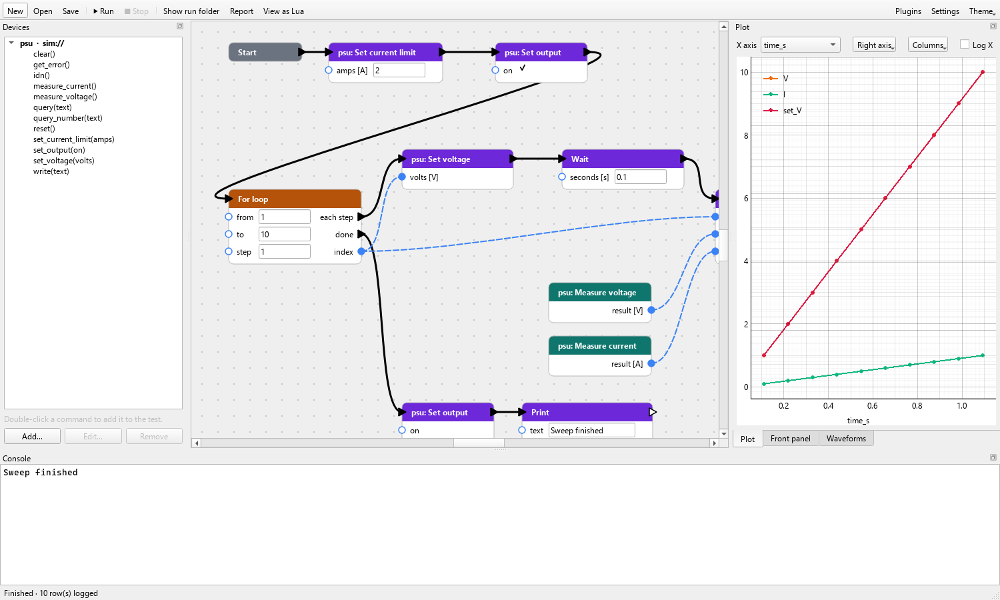

# Visual tests

A visual project's test is built from nodes connected by wires. It runs the
same way as a script: it is compiled to Lua and run by the same engine, so it
has the same instruments, checks, waveforms and front panel.

## Wires

Nodes are connected by two kinds of wire:

- **Thick wires** say what runs next. The test starts at the **Start** node
  and follows them.
- **Dashed blue wires** carry values from an output pin to an input pin.

Inputs without a wire are typed into the node itself. Wiring an input hides
its field.

## Editing

| To | Do |
|---|---|
| add a node | right-click the canvas; the menu lists flow, output and value nodes, the front panel, and every command of the project's instruments |
| add a command | double-click it in the **Devices** panel |
| wire | drag from a pin to a pin |
| delete | select, then Delete |
| undo, redo | Ctrl+Z, Ctrl+Y |
| copy, cut, paste | Ctrl+C, Ctrl+X, Ctrl+V; the wires between the selected nodes come along, also into another project |
| duplicate | Ctrl+D |
| select several | drag a frame on the canvas, or Ctrl+click |

The canvas and node menus offer the same.

## Nodes

### Flow

| Node | Does |
|---|---|
| **For loop** | runs **each step** for `from` to `to` in steps of `step`; `index` is the current value; then continues at **done** |
| **Repeat while** | runs **each step** while `condition` is true |
| **If** | runs **true** or **false**, then continues at **then continue** |
| **Wait** | waits `seconds` |
| **Fail test** | ends the test as failed, with `message` |

### Output

| Node | Does |
|---|---|
| **Log row** | adds one row of data; right-click it to add or remove columns |
| **Print** | writes `text` to the console |
| **Check (pass/fail)** | a [pass/fail check](lua.md#passfail-checks); `passed` says whether it passed |
| **Save waveform** | saves `traces` from a scope, see [Waveforms](lua.md#waveforms) |

### Values

| Node | Gives |
|---|---|
| **Math** | `a` + − × ÷ `b` |
| **Compare** | `a` < ≤ > ≥ = ≠ `b`, as true or false |
| **And / or**, **Not** | logic on true and false |
| **Elapsed time** | seconds since the run started |
| **Set variable**, **Variable** | store a value under a name, and read it back |

### Instruments and the front panel

Every command of every instrument in the project is a node, with its
arguments as inputs. **Front panel** nodes read a control or set an indicator
of the [front panel](front-panel.md).

## When a measurement happens

A node without thick-wire pins, such as a measurement, has no place in the
run order: it runs each time a node that uses its value runs. A **Log row**
with **Measure voltage** wired in measures at the moment the row is logged.

To measure at one fixed point and keep that value, right-click the
measurement and choose **Run in sequence**: it gets thick-wire pins, runs when
the sequence reaches it, and every node wired to it gets that same value.

## Running

While the test runs, a green outline marks the node it is at. A node with a
problem is outlined in red, both before the run (a missing value, a circle of
wires) and when it fails during the run.

**View as Lua** shows the Lua the test becomes; each run folder keeps it as
`graph.lua`. A visual project cannot be turned into a Lua project, but that Lua
is a good start for one.
